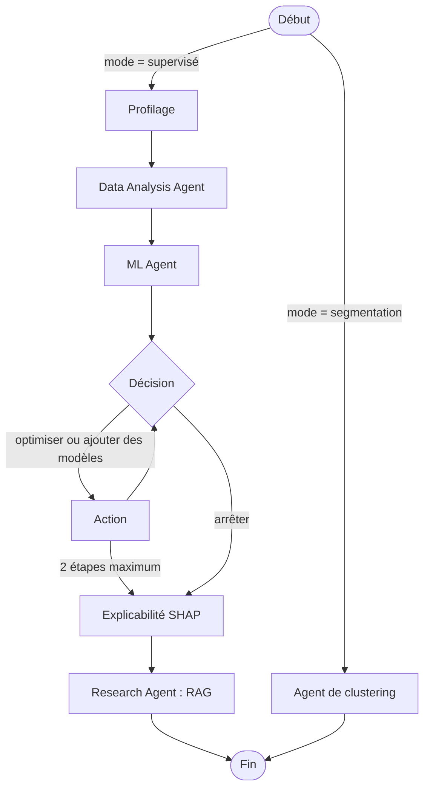

# AI Research Agent

Agent d'analyse de données **tabulaires** qui profile un jeu de données, entraîne et compare des modèles (classification ou régression), explique le modèle retenu, ou segmente les données sans cible. Chaque décision est **contrainte par des règles déterministes** et **tracée** dans un rapport Markdown.

Tout tourne en local (LLM via Ollama, aucune API externe). Développé et testé sous Windows, sur un portable CPU de 8 Go de RAM.

## En bref

- **Deux modes** : prédire une colonne (supervisé) ou segmenter les données (clustering).
- **Principe de conception** : le LLM propose parmi des choix fermés, le code valide, corrige et trace chaque correction. Si le LLM échoue, des règles de repli prennent le relais.
- **Rapport complet** : résultats, décisions, justifications sourcées (RAG), limites générées par des règles, tableau de traçabilité.
- **Benchmarks honnêtes** : 7 jeux supervisés et 8 cas de segmentation, avec ablations. Les résultats sont plus nuancés que ce qu'un projet « d'agent » annonce d'habitude (voir [Résultats](#résultats-des-benchmarks)).

> **Résumé honnête.** Sur les jeux testés, l'agent égale un pipeline fixe **correctement optimisé** : aucun avantage démontré, aucun désavantage net. Le gain contre un pipeline naïf vient de l'optimisation d'hyperparamètres, pas des décisions de l'agent. Le LLM (qwen2.5:3b) ne change pas la précision mesurée ; il multiplie le temps par 3,5 à 14. L'intérêt du projet est l'ingénierie : garde-fous, traçabilité, benchmark avec ablations.

## Architecture



Le rapport est produit après le graphe (agent de reporting pour le mode supervisé, rapport de segmentation pour le clustering). L'orchestration est faite avec LangGraph ; les expériences sont suivies avec MLflow.

| Composant | Rôle | Qui décide |
|---|---|---|
| Profilage | types, manquants, déséquilibre, corrélations, colonnes constantes | code |
| Data Analysis Agent | colonnes à supprimer, imputation, rééquilibrage, métrique | LLM dans un choix fermé, puis règles qui corrigent |
| ML Agent | modèles à comparer | LLM dans une liste fermée, puis règles (baseline linéaire toujours incluse) |
| Boucle d'optimisation | optimiser le modèle retenu, ajouter des modèles ou arrêter | LLM, puis règles (budget borné, modèle le plus simple dans l'écart-type du meilleur) |
| SHAP | importance des variables | code |
| Research Agent | justification de chaque décision par une note de la base de connaissances | code choisit la source, le LLM choisit une phrase |
| Reporting | rapport Markdown | code (le résumé du LLM n'est gardé que s'il passe la validation) |
| Clustering | choix de l'algorithme, du nombre de groupes, verdict « structure ou non » | code uniquement |

### Garde-fous (ce qui fait la différence)

- **Sorties structurées** : le LLM répond en JSON validé par Pydantic, avec des champs `Literal` (liste fermée), des retries, puis un plan par défaut si tout échoue.
- **Règles de correction tracées** : par exemple `accuracy` remplacée par une métrique adaptée quand les classes sont déséquilibrées, `average_precision` interdite en multiclasse, `undersampling` écarté quand il reste trop peu d'exemples minoritaires, un modèle sans `class_weight` exclu quand cette stratégie est choisie. Chaque correction apparaît dans le rapport.
- **Aucune fuite de données** : prétraitement, rééquilibrage et modèle sont dans un seul pipeline, ajusté sur chaque fold d'entraînement.
- **Citations extractives** : les justifications sont des phrases de la base de connaissances, citées avec leur source. Le LLM ne les réécrit pas (essayé et abandonné : un 3B mélange les langues et déforme le sens).
- **Résumés validés** : un résumé écrit par le LLM est rejeté s'il contient un chiffre absent des faits, mélange les langues, est trop long ou omet le nom de la métrique.

## Fonctionnalités

### Mode supervisé

- Classification binaire et multiclasse, régression.
- Catalogue de modèles : régression logistique ou ridge, forêt aléatoire, extra trees, XGBoost, LightGBM, gradient boosting natif de scikit-learn, SVM, k-NN. Éligibilité vérifiée par le code (SVM limité à 5 000 lignes et exclu avec `roc_auc` multiclasse, k-NN exclu avec `class_weight`).
- Optimisation d'hyperparamètres avec Optuna (budget borné), suivi MLflow de chaque run.
- SHAP : explainers natifs pour les modèles linéaires et à arbres, explainer par permutation (sur un échantillon réduit) pour SVM, k-NN et le gradient boosting de scikit-learn.
- Rapport : résultats, décisions, SHAP, justifications sourcées, limites, traçabilité.

### Mode segmentation

- Algorithmes : KMeans, classification hiérarchique (Ward), mélange gaussien ; k de 2 à 8.
- Choix par silhouette, Davies-Bouldin, Calinski-Harabasz et **stabilité** (ARI entre deux sous-échantillons de 80 %).
- **Verdict « structure ou pas »** : la silhouette retenue doit dépasser de 0,10 celle de données sans groupes (colonnes mélangées, et gaussienne de même covariance, 10 répétitions), avec une stabilité d'au moins 0,6. Sinon l'outil répond « aucun groupe clair » et ne propose aucun segment.
- Affinement : un segment d'au moins 200 lignes est subdivisé s'il contient lui-même de la structure (une seule passe, sous-groupes d'au moins 50 lignes et 10 % du segment).
- Profil de chaque segment par écart standardisé à la moyenne. **Les titres sont produits par des règles** (le LLM peut les proposer en option, désactivé par défaut : voir les limites).

## Résultats des benchmarks

Tous les jeux sont **hors ligne** (inclus dans scikit-learn ou générés). Les scripts sont dans `benchmark/`, les résultats bruts dans `benchmark/results.csv` et `benchmark/cluster_results.csv`.

### Benchmark supervisé

**Protocole.** Pour chaque graine (5), les données sont coupées en train (70 %) et test (30 %, stratifié en classification). L'agent ne voit que le train. Le modèle final est noté sur le test avec une **métrique fixée par nous** (jamais choisie par l'agent). Le pipeline fixe choisit son modèle avec cette même métrique, ce qui est généreux pour lui.

Configurations :

- `fixe` : médiane, aucun rééquilibrage, aucune suppression de colonne, pas d'optimisation, meilleur des 4 modèles de base en validation croisée.
- `fixe_opt` : `fixe` + la même optimisation Optuna (10 essais) sur son meilleur modèle.
- `agent sans LLM` : tout le code de l'agent, avec un faux LLM qui échoue toujours (les agents retombent sur leurs règles).
- `agent + LLM` : qwen2.5:3b. Lancé sur 5 jeux sur 7 seulement.
- Ablations : `fixe_cols` (colonnes supprimées par les règles), `fixe_cw` (`class_weight`), `regles_sans_opt` (agent sans l'étape d'optimisation).

Score moyen ± écart-type sur 5 graines (SHAP, RAG et rapport sont exclus du benchmark : ils ne changent aucune décision de modélisation) :

| Jeu (métrique d'évaluation) | `fixe` | `fixe_opt` | Agent sans LLM | Agent + LLM (3b) |
|---|---|---|---|---|
| cancer (ROC AUC) | 0.9870 ± 0.0062 | 0.9869 ± 0.0065 | 0.9928 ± 0.0040 | 0.9931 ± 0.0044 |
| rare_synth (average precision) | 0.5904 ± 0.0390 | 0.6488 ± 0.0386 | 0.6379 ± 0.0259 | 0.6379 ± 0.0259 |
| wine (F1 macro) | 1.0000 ± 0.0000 | 0.9927 ± 0.0163 | 0.9819 ± 0.0255 | 0.9819 ± 0.0255 |
| digits (F1 macro) | 0.9688 ± 0.0083 | 0.9677 ± 0.0070 | 0.9656 ± 0.0113 | 0.9656 ± 0.0113 |
| diabetes (RMSE, plus bas = mieux) | 54.68 ± 1.05 | 54.64 ± 1.07 | 54.64 ± 1.07 | 54.64 ± 1.07 |
| xor_synth (ROC AUC) | 0.9745 ± 0.0071 | 0.9736 ± 0.0097 | 0.9718 ± 0.0087 | non lancé |
| friedman (RMSE, plus bas = mieux) | 1.5184 ± 0.0638 | 1.4334 ± 0.0651 | 1.4334 ± 0.0651 | non lancé |

`cancer`, `wine`, `digits`, `diabetes` : jeux réels de scikit-learn. `rare_synth` (3 % de positifs, avec défauts injectés), `xor_synth` et `friedman` : synthétiques.

**Ce que les chiffres montrent**

1. **Contre un pipeline naïf**, l'agent gagne sur `rare_synth` (+0.0475 d'average precision, 5 graines sur 5) et sur `friedman` (RMSE −5,6 %).
2. **Les ablations attribuent ce gain à l'optimisation d'hyperparamètres.** Sur `rare_synth`, `fixe_cols` ne change rien (−0.0001), `fixe_cw` donne +0.0079 (3 victoires, 2 défaites) et `regles_sans_opt` +0.0028, alors que `fixe_opt` atteint 0.6488 (+0.0584 contre `fixe`).
3. **Contre `fixe_opt`, aucun avantage démontré** : écarts de signes mélangés (agent meilleur sur `cancer`, moins bon sur `rare_synth`, `wine`), tous à moins de 1,6 erreur standard.
4. **Le LLM n'a pas d'effet mesurable sur la précision** : score identique à l'agent sans LLM sur 4 jeux sur 5 (les 5 graines), un seul run différent sur `cancer` (+0.0003 en moyenne). Coût : temps multiplié par 3,5 (`digits`) à 14 (`cancer`), et environ 3 à 7 corrections des règles par run contre 0 à 1 sans LLM.
5. **La règle de simplicité (modèle le plus simple à moins d'un écart-type du meilleur) est mitigée** : elle aide sur `cancer` quand le pipeline fixe retient une forêt (graines 0 et 3), elle coûte sur `wine` (très petit jeu, 124 lignes d'entraînement). Sur `xor_synth`, l'agent garde bien des modèles d'arbres (jamais le linéaire), mais perd 0.0027 d'AUC contre `fixe` (4 graines sur 5) ; ce mécanisme n'est pas isolé.

**Limites du protocole** : 5 graines tirées des mêmes données (découpages non indépendants), aucun test statistique, jeux plutôt faciles pour les modèles linéaires, un seul LLM testé, et `rare_synth` ne compte qu'environ 36 positifs dans chaque jeu de test.

### Benchmark de segmentation

**Protocole.** Les étiquettes sont retirées avant le clustering et servent à calculer l'ARI. L'**oracle** est un KMeans qui connaît le vrai nombre de groupes : il donne le plafond de ce qu'un KMeans peut faire. 3 graines par cas ; sur des données fixes, elles vérifient la reproductibilité de l'algorithme, pas sa généralisation.

| Cas | Structure détectée (3 graines) | Segments | ARI de l'outil | ARI de l'oracle |
|---|---|---|---|---|
| blobs4 (4 groupes nets) | 3 sur 3 | 4 | 1.000 | 1.000 |
| blobs_overlap (4 groupes qui se chevauchent) | 3 sur 3 | 3 | 0.711 | 0.929 |
| iris (3 classes) | 3 sur 3 | 2 | 0.568 | 0.620 |
| cancer (2 classes, 30 variables) | 3 sur 3 | 2 | 0.660 | 0.654 |
| moons (2 croissants) | 3 sur 3 | 2 | 0.499 | 0.499 |
| wine (3 classes) | **1 sur 3** | 3 si détecté | 0.897 | 0.897 |
| noise (aucune structure) | 0 sur 3 | n/a | n/a | n/a |
| gauss_corr (gaussienne corrélée, aucun groupe) | 0 sur 3 | n/a | n/a | n/a |

**Ce que les chiffres montrent**

- **Aucun faux positif** sur les deux jeux sans structure (6 exécutions).
- Quand une structure est détectée, la partition **égale celle de l'oracle** (`wine`, `cancer`, `moons`, `blobs4`) ; l'outil sous-segmente quand des groupes se chevauchent (`iris`, `blobs_overlap`).
- **`wine` est un faux négatif instable** : le verdict dépend de l'initialisation de KMeans, dont la solution à 2 groupes passe tantôt dans la tolérance de choix (0,02 de silhouette), tantôt non. Le choix est volontairement conservateur : mieux vaut dire « aucun groupe clair » à tort que d'inventer des segments.
- **`moons` est détecté de justesse** : la marge de silhouette (+0.104) dépasse le seuil de 0.10 de 0.004. Elle n'est stable qu'avec 10 répétitions de la silhouette nulle (avec 3, une graine sur 6 basculait).
- Sur les croissants, la partition est mauvaise (ARI 0.499) mais égale à l'oracle : la limite vient de KMeans, pas de la sélection.
- Les seuils (stabilité 0,6, marge 0,10, poids 0,3 des variables catégorielles, tailles minimales des sous-segments) ont été fixés **avant** ce benchmark, sur des jeux synthétiques. Un nouveau réglage fait sur ces 8 cas ne serait plus évaluable : il faudrait un lot de validation défini à l'avance.

## Installation et utilisation

### Prérequis

- Python 3.12
- [Ollama](https://ollama.com) avec les modèles :

```bash
ollama pull qwen2.5:3b
ollama pull nomic-embed-text
```

`qwen2.5:3b` (environ 2 Go) tient sur une machine de 8 Go. Le 7b fonctionne mais est beaucoup plus lent.

### En local

```bash
python -m venv .venv
.venv\Scripts\activate          # Windows ; sous Linux/macOS : source .venv/bin/activate
pip install -r requirements.txt
streamlit run app/main.py       # http://localhost:8501
```

Dans l'interface : charger un CSV, choisir « Prédire une colonne » (avec la colonne cible) ou « Segmenter les données », puis lancer. Les colonnes d'identifiants peuvent être ignorées. L'index de la base de connaissances se construit au premier lancement.

### Avec Docker

```bash
docker compose up --build
```

- Application : http://localhost:8501
- Interface MLflow : http://localhost:5000

Ollama reste sur la machine hôte (le conteneur s'y connecte via `host.docker.internal`). L'état (base MLflow, index, sorties) est dans un volume Docker nommé : `docker compose down -v` le réinitialise. Les scores obtenus dans le conteneur sur le jeu de démonstration étaient identiques à ceux obtenus en local.

### Reproduire les benchmarks

```bash
# supervisé (résultats ajoutés à benchmark/results.csv, reprise automatique si interrompu)
python -m benchmark.runner --configs fixe fixe_opt regles --seeds 5
python -m benchmark.runner --datasets cancer rare_synth wine diabetes digits --configs llm --seeds 5
python -m benchmark.report regles          # tableaux et écarts appariés par graine

# segmentation
python -m benchmark.cluster_bench
```

Les configurations sans LLM prennent environ 20 à 30 minutes sur la machine de développement (CPU, 8 Go) ; la campagne avec LLM, 45 à 60 minutes. Les runs MLflow du benchmark sont isolés dans `benchmark/state`.

## Structure du dépôt

```
app/            interface Streamlit
agents/         agents (données, ML, optimisation, recherche, reporting, clustering) et orchestrateur LangGraph
tools/          profilage, entraînement, optimisation, SHAP, RAG, clustering, profils de segments
schemas/        modèles Pydantic des plans, résultats et rapports
llm/            client Ollama (sorties structurées, retries)
benchmark/      jeux de données, exécuteur, rapport, benchmark de segmentation
data/knowledge/ notes de la base de connaissances (7 fichiers Markdown, en français)
tests/          scripts de vérification et de diagnostic, à lancer à la main
config.py       chemins et suivi MLflow (configurable par STATE_DIR)
```

`tests/` contient des **scripts exécutables à la main** (vérifications et diagnostics écrits au fil du développement), pas une suite `pytest` avec assertions systématiques.

## Limites connues

- **Données tabulaires uniquement** : pas de séries temporelles (le découpage aléatoire ne convient pas), de texte ni d'images.
- **Aucun gain démontré face à un pipeline fixe optimisé** (voir les résultats). L'outil automatise et trace des bonnes pratiques.
- **Le rôle du LLM est limité.** Avec un modèle de 3 milliards de paramètres, les textes libres étaient souvent faux ou vagues (chiffres inventés, langues mélangées, titres sans fondement) : les descriptions de segments et les justifications sont donc produites par le code. Les titres LLM existent en option (`use_llm_titles=True`) mais ne sont pas utilisés : ils passent les contrôles de format sans garantie de sens. Seul qwen2.5 (3b, et 7b sur quelques essais) a été testé.
- **Jeux de benchmark** : trois sur sept sont synthétiques ; les défauts injectés dans `rare_synth` correspondent à ce que les règles savent détecter.
- **Base de connaissances** : 7 notes écrites par l'auteur (une quarantaine de passages). La recherche retrouve la bonne section dans 7 cas sur 8 d'un test dédié, mais ne sépare pas les questions hors sujet (les distances se recouvrent) : l'agent n'effectue donc aucune recherche libre, il interroge des sources choisies par le code.
- **Segmentation** : KMeans et le mélange gaussien supposent des groupes arrondis ; les groupes qui se chevauchent sont fusionnés ; clustering calculé sur au plus 5 000 lignes ; les seuils sont des heuristiques non calibrées sur données réelles ; le verdict de `wine` dépend de l'initialisation.
- **SHAP décrit le modèle, pas la réalité** : pas de relation causale, et le crédit est réparti entre variables corrélées. Pour SVM, k-NN et le gradient boosting de scikit-learn, l'explication par permutation porte sur 50 lignes : elle est approximative.
- **Pas de calibration des probabilités**, pas de validation croisée imbriquée : le score d'un modèle optimisé est légèrement optimiste.
- **Testé sous Windows** (et dans Docker) ; non testé sous Linux ou macOS en natif.

## Données et références

Jeux de données inclus dans scikit-learn : Breast Cancer Wisconsin (Diagnostic), Wine, Optical Recognition of Handwritten Digits, Iris (UCI Machine Learning Repository) ; Diabetes (Efron, Hastie, Johnstone, Tibshirani, « Least Angle Regression », 2004). Jeux synthétiques générés par `make_classification`, `make_blobs`, `make_moons`, `make_friedman1` et par des générateurs du dépôt.


